# Mariano Gerardus Senduk

### AI research and product engineering, guided by a long-term interest in AGI.

`Computer Science @ Universitas Indonesia` - `AI research` - `Product engineering`

---

I'm a Computer Science undergraduate at Universitas Indonesia. I'm interested in the foundations of intelligence and in building software that puts those ideas to use. My work spans research experiments and product engineering, with a growing interest in how AI can help people in their everyday workflows.

Contributing to AGI is my long-term direction. For now, that means learning how models behave, testing ideas carefully, and building systems people can use.

## Current Direction

- **Researcher Intern at LEXIN, Universitas Indonesia (Aug 2026 - present):** my undergraduate thesis studies how LLMs can translate Indonesian judicial reasoning into symbolic representations while preserving the source meaning. I built a Python prototype for translation, validation, and reconstruction; semantic evaluation is ongoing.
- Working across **AI research and engineering**, from reinforcement learning and multilingual retrieval to speech deepfake detection and time-series modeling.
- Exploring product thinking, business, and finance alongside the technical work, and documenting projects at [marianosenduk.app](https://marianosenduk.app).

## Product Engineering Experience

**AI Product Engineer, Klaussa.com | Jan 2026 - Jul 2026**

Worked with end-to-end ownership in a legal-tech startup, understanding user workflows and delivering features across AI, backend, data, and frontend systems.

## Education

**Bachelor of Computer Science, Universitas Indonesia | 2022 - Now**

Coursework includes information retrieval, reinforcement learning, deep learning, speech processing, algorithms, and software engineering.

## Things I Build

| Area | What I am exploring |
|---|---|
| **AI research** | Information retrieval, speech, computer vision, reinforcement learning, legal NLP, neuro-symbolic AI, evaluation |
| **Software systems** | Web apps, APIs, CLI tools, MCP servers, mobile clients, infrastructure, maintainable code |
| **AI product** | RAG, legal AI, document workflows, content automation, user-facing AI reliability |
| **Product / project management** | Scope, planning, stakeholder communication, delivery, user flows |
| **Business / finance** | Forecasting, market research, dashboards, operations, strategic reasoning |
| **Creative software** | Portfolio design, games, custom tools, interaction concepts |

## Tech Constellation

**Languages**  

  
  
  
  
  

**AI / Data**  

  
  
  
  
  
  

**Web / Product**  

  
  
  
  
  
  
  

**Tools**  

  
  
  
  
  

## Featured Projects

| Project | Description | Focus |
|---|---|---|
| [**Pandemic-response MDP and deep RL**](https://github.com/nano141004/virus-outbreak-modeling-rl) | Four-city stochastic SEIRD environment with a 22-dimensional state and 5.3M intervention combinations. Compared PPO, A2C, and a restricted DQN baseline; PPO's mean return was 32.36 ± 12.98 over 30 held-out simulation seeds. | RL, MDP, Gymnasium, policy evaluation |
| [**ListT5 reranker extension**](https://github.com/nano141004/exp-extend-list5) | Inference-only study of candidate grouping and tournament caching across five BEIR datasets, keeping checkpoints fixed and measuring NDCG@10, model calls, and latency. | IR, reranking, experimental design |
| [**Mini search engine**](https://github.com/nano141004/mini-search-engine) | Indexing and compressed postings, TF-IDF, BM25, WAND, LSI, and FAISS HNSW; evaluated on 30 annotated queries using RBP, NDCG, and Average Precision. | IR, search systems |
| [**CustomChessKell**](https://github.com/nano141004/CustomChessKell) | Mini functional-programming chess engine built in Haskell with custom movement logic. | Haskell, DSL, game logic |
| [**GameJam**](https://github.com/nano141004/GameJam) | Plaguewalker, an endless runner game inspired by the Google Dino game and built with Godot 4.3. | Godot, game dev |
| [**self-org / pal (ongoing)**](https://github.com/nano141004/self-org) | Local-first personal knowledge tool with CLI and MCP interfaces, exploring how free-form captures can be organized into a Markdown knowledge base. | Python, MCP, LLM orchestration |
| [**marianosenduk.app**](https://marianosenduk.app) | Responsive portfolio site for education, projects, skills, experience, and long-term direction. | Astro, portfolio, web |

## Most Used Languages

## Find Me

  
  
  

---

Still exploring. Still building. Still chasing the horizon.

